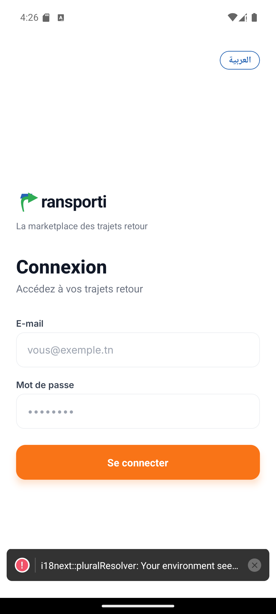
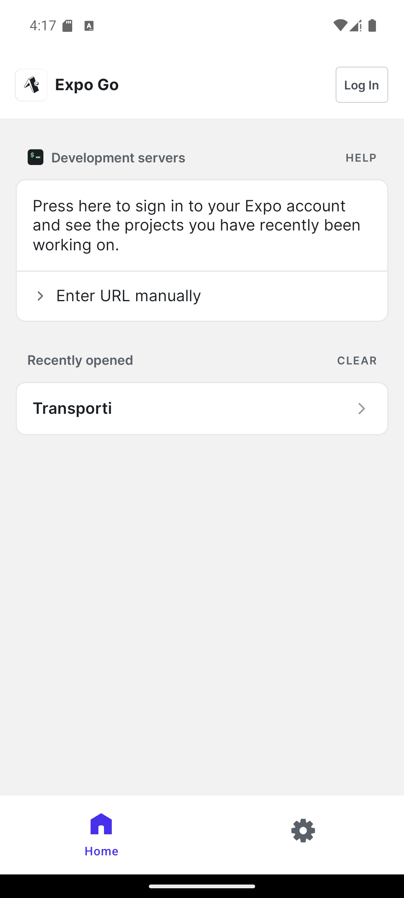
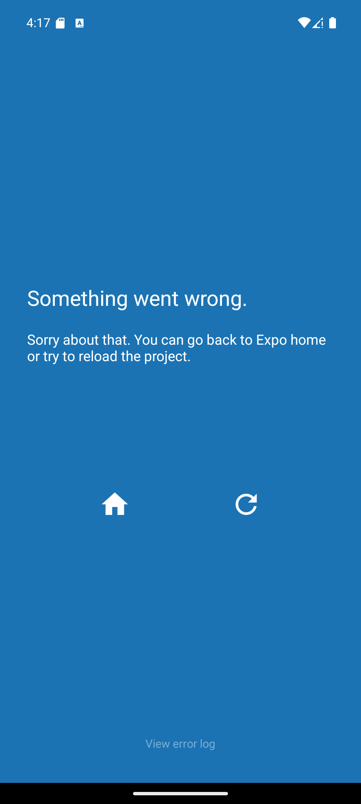
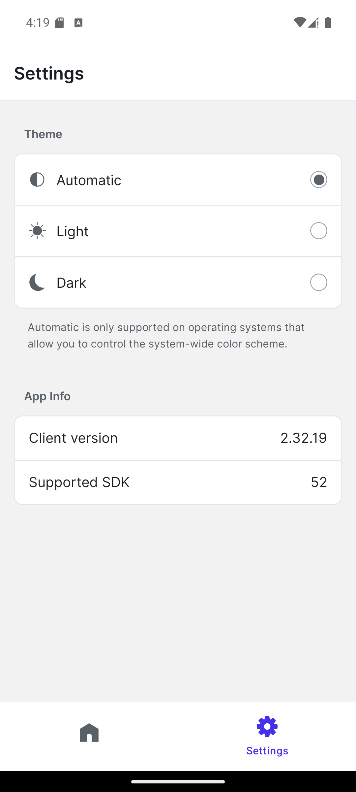
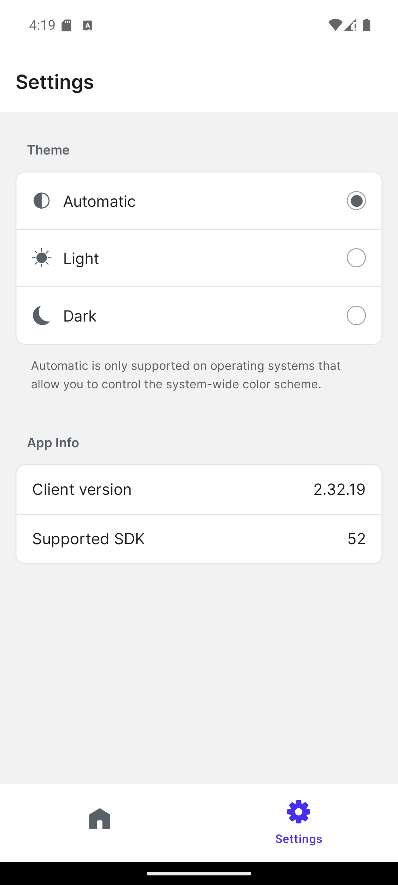

# Audit UI — parcours transporteur (mobile), 30/07/2026

Audit des interfaces graphiques du **rôle transporteur** de l'application mobile
Transporti, réalisé en exécution réelle sur émulateur Android, avec backend et
base de données live. Complète `AUDIT_PARCOURS_TRANSPORTEUR_2026-07-14.md`
(qui portait sur le parcours métier, pas sur l'UI mobile).

- **Date** : 30/07/2026
- **Périmètre** : 8 écrans du rôle `TRANSPORTER`, hors parcours client
- **Méthode** : pilotage de l'émulateur (`mobile-mcp`), lecture de l'arbre
  d'accessibilité, recoupement systématique avec l'API et la base
- **Captures** : `assets/audit-ui-transporteur-2026-07-30/`

---

## 1. Topologie du système testé

Quatre composants en jeu, tous en local :

```
┌──────────────────┐   deep link exp://10.0.2.2:8082
│  Émulateur AVD   │◄──────────────────────────────────┐
│  Pixel_7_API_35  │                                   │
│  Android 15      │   bundle JS + HMR         ┌───────┴────────┐
│  1080×2400, 420  │◄──────────────────────────│  Metro : 8082  │
│                  │                           └────────────────┘
│  Expo Go         │   REST /api/v1/*          ┌────────────────┐
│ host.exp.exponent│──────────────────────────►│ Django : 8000  │
└──────────────────┘   JWT Bearer              │  + SQLite      │
         ▲                                     └────────────────┘
         │ adb (uiautomator, input, screencap)
    ┌────┴─────┐
    │mobile-mcp│
    └──────────┘
```

**Points de configuration indispensables** (sinon rien ne fonctionne) :

| Élément | Valeur | Conséquence si absent |
|---|---|---|
| `EXPO_PUBLIC_API_BASE_URL` | `http://10.0.2.2:8000` | l'app ne joint pas l'hôte |
| `ALLOWED_HOSTS` | doit inclure `10.0.2.2` | Django répond **400** |
| Port Metro | `8082` | 8081 est pris par `expo start --web` |
| URL Expo Go | `exp://10.0.2.2:8082` | `127.0.0.1` échoue en *connection refused* même avec `adb reverse` |

Projet en **workflow Expo managé** : pas de dossier `android/`, pas de
`AndroidManifest.xml`, et le package `tn.transporti.app` déclaré dans
`app.json` **n'existe pas** sur l'appareil. Le seul package installé est
`host.exp.exponent` (Expo Go). Toute tentative de lancement direct par package
échoue ; il faut passer par le deep link.

---

## 2. Compte de test et entrées exactes

Compte utilisé — `backend/users/management/commands/seed_test_data.py` :

| Champ | Valeur |
|---|---|
| E-mail | `mehdi.khelifi@test.transporti.tn` |
| Mot de passe | `Test@123!` |
| `user_id` | 43 |
| Rôle | `TRANSPORTER` |
| Statut de confiance | `VERIFIED` |
| Téléphone | `+21650222001` |

### Séquence d'entrées rejouable

| # | Action | Cible | Entrée |
|---|---|---|---|
| 1 | deep link | `host.exp.exponent` | `exp://10.0.2.2:8082` |
| 2 | tap | champ E-mail | `(540, 1367)` |
| 3 | saisie | — | `mehdi.khelifi@test.transporti.tn` |
| 4 | tap | champ Mot de passe | `(540, 1607)` |
| 5 | saisie | — | `Test@123!` |
| 6 | bouton | BACK | fermeture du clavier |
| 7 | tap | « Se connecter » | `(540, 1807)` |
| 8 | tap | fermeture du toast d'erreur | `(996, 2243)` |
| 9 | tap | onglet Demandes | `(348, 2225)` |
| 10 | tap | 1re carte de trajet | `(540, 571)` |
| 11 | tap | FAB Publier | `(540, 2200)` |
| 12 | swipe | haut, 900 px | déroulé du formulaire |
| 13 | tap | onglet Messages | `(731, 2225)` |
| 14 | tap | onglet Profil | `(920, 2225)` |
| 15 | tap | ligne « Vérification » | `(540, 1105)` |

Coordonnées de la barre d'onglets (centres, relevés dans l'arbre
d'accessibilité) : Accueil `(161, 2225)` · Demandes `(348, 2225)` ·
Publier `(540, 2200)` · Messages `(731, 2225)` · Profil `(920, 2225)`.

---

## 3. Écrans

### 3.0 Connexion — point d'entrée



Bascule de langue `العربية` en haut à droite, logo + accroche, formulaire
e-mail / mot de passe, CTA orange « Se connecter ».

Deux observations dès cet écran, avant toute authentification :

- Le toast d'erreur `i18next` est déjà présent (cf. §4.1) et occupe le bas de
  l'écran.
- Le logo est exposé comme `text="ransporti"` dans l'arbre d'accessibilité
  (cf. §4.2).

### 3.1 Accueil — conforme


En-tête « Bienvenue, Mehdi » + avatar `M`, badges **Transporteur** et
**✓ Vérifié**, CTA « Publier un retour », section « Mes missions ».

Le rôle et le prénom sont exacts : les deux correctifs d'authentification
appliqués plus tôt dans la session tiennent (redirection après connexion, et
plus de rétrogradation silencieuse du rôle en `CLIENT` au rechargement).

### 3.2 Demandes reçues — écran le plus dégradé



Source : `GET /api/v1/jobs/transporter/` → **200**, 11 045 octets, 20 trajets.

**Tri par `id` décroissant, pas par date.** Ordre effectivement renvoyé :

```
id=571  27/07     id=561  31/07     id=551  21/07
id=570  26/07     id=560  30/07     id=550  03/08
id=566  22/07     id=556  26/07     ...
```

À l'écran cela donne 27/07, 26/07, 22/07, 21/07, **31/07**, 30/07, 26/07 —
illisible chronologiquement.

**Trajets passés toujours `PUBLISHED`.** Au 30/07, les trajets des 21, 22, 24,
25, 26, 27 et 29/07 restent publiés. Les commandes `archive_old_jobs` et
`expire_offers` existent dans `logistics/management/commands/` mais ne sont
manifestement pas planifiées.

**Aucun compteur de demandes sur les cartes.** Vérification exhaustive des 20
trajets via `GET /api/v1/jobs/<id>/requests/` :

```
TOTAL demandes sur ses 20 trajets : 0
```

Le transporteur doit donc ouvrir 20 écrans pour découvrir 20 fois un état vide.
La finalité même de l'écran est invérifiable : le seed crée 6 `Offer` pour ce
compte mais **aucune demande de trajet**.

Cosmétique aggravant : toutes les heures valent `19:05`.

Étiquette d'accessibilité des cartes : `"Tunis, Sousse, 27/07 19:05, "` — la
virgule finale vient du chevron sans libellé.

### 3.3 Détail d'un trajet — trop pauvre



Uniquement « Tunis → Sousse » et « Aucune demande sur ce trajet. ». Ni date, ni
prix, ni capacité, ni statut, et **aucune action** (modifier, annuler,
dupliquer). Le lien de retour indique « ← Mes trajets » alors que l'écran
d'origine s'intitule « Demandes reçues ».

### 3.4 Publier un retour


Formulaire complet et bien découpé : Type de trajet, Départ (gouvernorat +
adresse), Arrivée, Jour/Heure, estimation de prix, fourchette min/max,
capacité, description, réservation immédiate, publication.

Bon point d'architecture : « Estimer le prix » et la mention « Fourchette
indicative **calculée par le serveur** » respectent la règle projet
« argent = calcul serveur uniquement ».

Défauts :

1. **La barre d'onglets flottante recouvre les champs Jour / Heure** — il
   manque un `paddingBottom` sur le conteneur scrollable, de la hauteur de la
   tab bar.
2. Placeholder tronqué : « Choisir une heu… ».
3. **Deux CTA pleine largeur concurrents** : « Estimer le prix » (bleu foncé,
   en milieu de formulaire) et « Publier le trajet » (orange). Le bleu peut se
   lire comme la soumission.
4. Section intitulée « Jour » contenant un champ également intitulé « Jour ».

### 3.5 Messages — hiérarchie inversée



Le **titre de chaque conversation est une adresse** (« Rue de Marseille,
La Marsa … »), et le nom de l'interlocuteur (« Leila B. ») est relégué en
sous-titre gris. On scanne une messagerie par personne, pas par adresse — et
les adresses tronquent systématiquement.

Aucun horodatage sur les conversations : impossible de savoir quand remonte le
dernier message.

### 3.6 Profil — identité incomplète


- L'identité affichée est **l'e-mail brut**, alors que le prénom est disponible
  (l'accueil affiche « Bienvenue, Mehdi »). Pas d'avatar non plus.
- **Pas de badge « Vérifié »**, alors que l'accueil et l'écran Vérification
  l'affichent : incohérence entre trois écrans.
- « Se déconnecter » est un bouton **primaire pleine largeur bleu foncé** —
  l'élément visuellement le plus fort de la page.
- Aucune donnée métier transporteur (véhicule, capacité, téléphone) ; elles
  sont enfouies dans « Vérification ».

### 3.7 Vérification



Sources : `GET /api/v1/trust/status/` → **200** (184 o) et
`GET /api/v1/trust/documents/` → **200** (**2 octets** = tableau vide).

- Capacité affichée **`2000.0`** : le `Decimal` du backend est rendu brut, sans
  formatage ni unité.
- **Statut « Vérifié » avec « Aucun document ».** L'UI ne réconcilie pas le
  statut de confiance avec les pièces justificatives — un transporteur est
  vérifié sans aucune preuve.

---

## 4. Défauts transverses

### 4.1 Le toast d'erreur bloque la navigation

Mesures relevées dans l'arbre d'accessibilité :

| Élément | Zone verticale |
|---|---|
| Toast `i18next` | `y 2146 → 2271` |
| Barre d'onglets | `y 2167 → 2283` |

Le recouvrement est quasi total : en développement, la navigation est
physiquement inaccessible tant que le toast n'est pas fermé.

L'erreur elle-même persiste :

```
i18next::pluralResolver: Your environment seems not to be Intl API compatible,
use an Intl.PluralRules polyfill. Will fallback to the compatibilityJSON v3
format handling.
```

Hermes sans `Intl` ⇒ repli en `compatibilityJSON v3`. La **pluralisation arabe**
(6 formes) est donc à risque, ce qui touche directement le bilinguisme FR/AR.

### 4.2 Le logo est annoncé « ransporti »

L'arbre d'accessibilité contient littéralement :

```json
{"type":"android.widget.TextView","text":"ransporti"}
```

La flèche verte remplace le `T` graphiquement mais n'a aucun équivalent
textuel. Les lecteurs d'écran annoncent donc « ransporti » — sur l'écran de
connexion comme sur l'accueil.

### 4.3 Cadence de sondage

Relevé sur 5 minutes d'application au repos :

```
17:03:36  GET /api/v1/notifications/unread-count/  200
17:03:51  GET /api/v1/notifications/unread-count/  200
17:04:06  GET /api/v1/notifications/unread-count/  200
17:04:21  GET /api/v1/notifications/unread-count/  200
17:04:36  GET /api/v1/notifications/unread-count/  200
```

**Un appel toutes les 15 s, en continu**, y compris sur des écrans qui
n'affichent pas de notifications. Sur mobile en données cellulaires, c'est
240 requêtes/heure pour 18 octets de réponse.

Sur l'écran de conversation, `conversations/` et `jobs/<id>/messages/`
s'ajoutent au rythme de ~5 s.

---

## 5. Échanges entre composants

Endpoints réellement sollicités par l'app (extraits de `backend/django.log`) :

| Endpoint | Appels | Statut | Rôle |
|---|---|---|---|
| `POST /api/v1/auth/login/` | 2 | 200 | ouverture de session (913 o) |
| `GET /api/v1/auth/profile/` | — | 200 | rechargement du profil au boot |
| `GET /api/v1/jobs/transporter/` | 3 | 200 | liste « Demandes reçues » (11 045 o) |
| `GET /api/v1/jobs/571/requests/` | 1 | 200 | demandes d'un trajet |
| `GET /api/v1/conversations/` | 19 | 200 | liste des messages |
| `GET /api/v1/notifications/unread-count/` | 22 | 200 | sondage 15 s |
| `GET /api/v1/trust/status/` | 1 | 200 | statut de vérification |
| `GET /api/v1/trust/documents/` | 1 | 200 | documents (vide) |
| `GET /api/v1/reviews/my/` | 1 | 200 | avis |
| `GET /api/v1/disputes/my/` | 1 | 200 | litiges |

Le préfixe **`/api/v1/`** est bien respecté de bout en bout ; le contrat
versionné tient.

**Réserve d'honnêteté** : le journal contient aussi des appels que **je n'ai pas
provoqués** — notamment un `POST /api/v1/jobs/1/messages/` → **201** à
17:01:38, ainsi que `reviews/my/` et `disputes/my/`. Une manipulation
manuelle de l'émulateur a eu lieu en parallèle de l'audit. Un message a donc
été réellement créé en base. Les écrans « Mes avis » et « Mes litiges » n'ont
pas été audités par moi.

### Chaîne d'authentification observée

```
1. POST /auth/login/            → 200, {user, tokens:{access, refresh}}
2. GET  /auth/profile/          → 401  (access expiré au retour d'appli)
3. POST /auth/token/refresh/    → 200  (rotation du refresh)
4. GET  /auth/profile/          → 200  (rejoué avec le nouveau token)
```

Le rafraîchissement automatique fonctionne : l'intercepteur rejoue bien la
requête après un 401. Point de vigilance : `/auth/profile/` renvoie le DTO
**encapsulé sous `user`** — c'était la cause de la rétrogradation de rôle
corrigée dans `src/features/auth/api/useProfile.ts`.

---

## 6. Constats consolidés

| # | Constat | Sévérité | Emplacement |
|---|---|---|---|
| 1 | Tri par `id` au lieu de la date | **Élevée** | `jobs/transporter/` |
| 2 | Aucun compteur de demandes sur les cartes | **Élevée** | Demandes reçues |
| 3 | Trajets passés toujours `PUBLISHED` | **Élevée** | `archive_old_jobs` non planifié |
| 4 | Toast d'erreur recouvrant la tab bar | **Élevée** | dev uniquement |
| 5 | Pluralisation AR à risque (`Intl` absent) | **Élevée** | i18n |
| 6 | Tab bar recouvrant les champs du formulaire | Moyenne | Publier |
| 7 | Statut « Vérifié » sans aucun document | Moyenne | Vérification |
| 8 | Logo annoncé « ransporti » | Moyenne | a11y globale |
| 9 | Détail de trajet sans données ni actions | Moyenne | Détail trajet |
| 10 | Adresse en titre de conversation | Moyenne | Messages |
| 11 | Sondage 15 s en continu | Moyenne | notifications |
| 12 | Profil sans nom ni badge vérifié | Faible | Profil |
| 13 | Capacité rendue `2000.0` | Faible | Vérification |
| 14 | Deux CTA concurrents | Faible | Publier |
| 15 | Libellés « Jour » dupliqués | Faible | Publier |
| 16 | Retour « Mes trajets » ≠ « Demandes reçues » | Faible | Détail trajet |

---

## 7. Recommandations, par effet de levier

1. **Trier `jobs/transporter/` par `scheduled_time`** et exclure les trajets
   échus — corrige à lui seul les constats 1 et 3.
2. **Afficher le nombre de demandes en attente sur chaque carte** — sans quoi
   l'écran principal du transporteur reste inutilisable (constat 2).
3. **Enrichir le seed avec des demandes de trajet** — le parcours d'acceptation
   n'est aujourd'hui pas testable du tout.
4. **Ajouter `Intl.PluralRules` (polyfill `@formatjs`)** — prérequis du
   bilinguisme AR.
5. `paddingBottom` sur le formulaire de publication, et `accessibilityLabel`
   « Transporti » sur le logo — deux corrections triviales.

---

## 8. Reproduire cet audit

```bash
# 1. backend (10.0.2.2 doit être autorisé)
cd backend && ALLOWED_HOSTS="localhost,127.0.0.1,10.0.2.2" \
  ./venv/Scripts/python.exe manage.py runserver 0.0.0.0:8000

# 2. émulateur + Metro + ouverture dans Expo Go
scripts/mobile-emulator.sh

# 3. inspection de l'UI sans mobile-mcp
scripts/mobile-ui.sh elements
scripts/mobile-ui.sh tap "Se connecter"
scripts/mobile-ui.sh shot mon-ecran
```

Avec `mobile-mcp` : `mobile_list_available_devices`, puis
`mobile_list_elements_on_screen` pour tout repérage (jamais de coordonnées
devinées), `mobile_save_screenshot` pour les captures.

> **Limite connue** : l'émulateur s'est arrêté trois fois pendant la session,
> dont une fois en pleine capture. Le lancement via `cmd start` (détaché) le
> fait survivre à l'arrêt de l'agent, mais pas à toutes les conditions —
> prévoir de vérifier `adb devices` avant chaque campagne.
